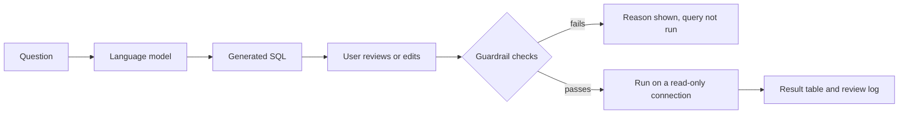

# Chinook SQL Assistant: Natural-Language Questions with Guardrails and Evaluation

[](https://colab.research.google.com/github/emmanuelkiprop448-sudo/llm-sql-assistant./blob/main/notebooks/run_in_colab.ipynb)

A Streamlit app for asking questions about a sample music-store database in plain English. A language model writes the SQL; the app checks it with read-only guardrails, shows it for review and editing, and only then runs it. A separate evaluation script measures how often the model's SQL returns the correct answer on a set of benchmark questions.

## Why this project

SQL written by a language model fails in predictable ways: invented column names, wrong joins, extra columns, or statements that would change data. This project treats every generated query as untrusted. Each query is checked before it runs, and accuracy is measured against reference answers rather than assumed.

## How it works



## Guardrails

Every query, generated or typed by hand, must pass these checks in order:

| Check | What it stops |
| --- | --- |
| Single statement | `SELECT ...; DELETE ...` style chaining |
| Starts with `SELECT` or `WITH` | Anything that is not a read |
| No data-changing keywords | `INSERT`, `UPDATE`, `DELETE`, `DROP`, `PRAGMA`, `ATTACH` and similar, ignoring text inside quotes and comments |
| Compiles against the schema | Unknown tables or columns and syntax errors, found with `EXPLAIN` before anything runs |

Queries that pass then run on a connection that is read-only twice over: the database file is opened in read-only mode, and an SQLite authorizer refuses every operation except reading. Results are capped at 500 rows and queries stop after 5 seconds.

## Evaluation

`eval/questions.json` holds 12 questions with hand-written reference queries, chosen so that each has a single correct answer (no ties at a `LIMIT` cut-off). The evaluation script asks the model each question, applies the same guardrails as the app, runs the generated query and compares its result with the reference result.

- **Strict accuracy:** the generated query returns exactly the reference rows and columns.
- **Lenient accuracy:** the reference columns are all present, with extra columns allowed.

Rows are compared in any order, numbers are rounded to two decimal places, and each failure is labelled: rejected by guardrails, failed when run, or ran with a wrong result. Results are written to `eval/results/summary.md` and `eval/results/results.csv`.

## Run it

**In the browser:** open the notebook with the "Open in Colab" button above. It runs the tests, lets you ask questions, and runs the benchmark with a free Gemini API key from Google AI Studio. Nothing is needed on your computer.

**On your computer:** you need Python 3.11 or later.

```bash
python -m venv .venv
source .venv/bin/activate          # Windows: .venv\Scripts\activate
pip install -r requirements.txt
```

**Choose a model.** Copy `.streamlit/secrets.toml.example` to `.streamlit/secrets.toml` and fill it in. Two options:

- **Ollama (free, local):** install Ollama, run `ollama pull qwen2.5-coder:7b`, and keep the example values.
- **A hosted provider:** any service with an OpenAI-compatible API. Set the model name, your key, and the provider's endpoint. For example, Google's Gemini API uses the endpoint `https://generativelanguage.googleapis.com/v1beta/openai/` with a key from [Google AI Studio](https://aistudio.google.com).

Then:

```bash
streamlit run app.py                   # the app (also works with no model: write SQL yourself)
python -m sql_assistant.evaluate       # benchmark the configured model
pytest                                 # tests, no model or key needed
```

The Chinook database (about 1 MB) downloads into `data/` on first run.

## Deploy on Streamlit Community Cloud

1. Push this repository to GitHub.
2. At [share.streamlit.io](https://share.streamlit.io), create an app from the repository with `app.py` as the main file.
3. In the app's settings, add `LLM_MODEL`, `LLM_API_KEY` and `LLM_BASE_URL` as secrets.

A model running in Ollama on your own computer can't be reached from the cloud, so the hosted app needs a hosted provider. Anyone with the link can use your API credit, so set a spending limit with the provider.

## Project structure

```
app.py                       Streamlit interface
sql_assistant/db.py          database download, guarded read-only connection, schema text
sql_assistant/guardrails.py  checks, SQL extraction and the query runner
sql_assistant/llm.py         model settings and the prompt
sql_assistant/compare.py     result comparison for scoring
sql_assistant/evaluate.py    benchmark runner
eval/questions.json          benchmark questions and reference SQL
tests/                       guardrail, scoring, evaluation and app tests
```

## Data

The [Chinook sample database](https://github.com/lerocha/chinook-database) by Luis Rocha, used under the MIT licence.
